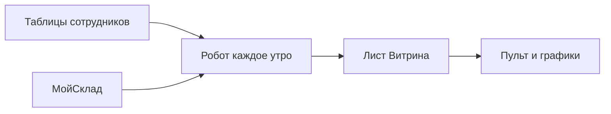

# Склад РемМонтаж

Пульт с пятью большими цифрами и таблица, куда робот складывает строки. Открывается в браузере. Отдельная программа на компьютер не ставится.

Заходить нужно почтой **alexsklad083@gmail.com**. С другой почты пульт не откроется.

## Куда нажимать

| Куда | Зачем |
| --- | --- |
| [Пульт](https://script.google.com/macros/s/AKfycbyrI9lD_y0La2LAlkWhrR0cra0V4yZSG6zeRDK72NFLlQYRrtsirsUhARjVqVBQTDDscw/exec) | Пять карточек: строки, поступления, списания, реклама, прибыль |
| [Мастер-реестр](https://docs.google.com/spreadsheets/d/1sjnqaU4-uJD_kjFwZWjnofPd25vQjtCqstktGWhXbe8/edit) | Все листы. Внизу цветные вкладки |
| [Графики](https://docs.google.com/spreadsheets/d/1sjnqaU4-uJD_kjFwZWjnofPd25vQjtCqstktGWhXbe8/edit?gid=390188976#gid=390188976) | Те же цифры столбиками |

Длинная инструкция с картинками лежит в файле [Руководство по пульту.html](Руководство%20по%20пульту.html). Рядом есть такой же документ Word.

## Откуда берётся цифра



Робот запускается около 07:00 по Москве. Сначала он кладёт копию книги в папку Диска «Бэкапы РемМонтаж». Хранятся 14 последних копий. Потом читает только франшизу со статусом **АКТИВЕН** и источники со статусом **Включать**.

Сейчас рабочая франшиза одна: **FR-001**, ООО «РемМонтаж». Статус **ОТКЛЮЧЕН**. Утром копирование проходит, новые строки робот не забирает. Учебный образец на пульте при этом виден.

## Пять карточек

Сейчас на пульте учебные числа. На строках написано **ТЕСТ**. Это не касса.

| Карточка | Сейчас | Что это |
| --- | ---: | --- |
| Строк в своде | 2 | Две учебные оплаты |
| Поступления | 15 000,00 | Деньги, которые пришли |
| Списания | 2 600,00 | Деньги, которые ушли |
| Расход Google Ads | 0,00 | Рекламный кабинет есть, кампании нет |
| Прибыль до себестоимости | 15 000,00 | Поступления минус реклама |

Списание на экране есть и в прибыль не входит. Себестоимость товаров тоже не вычитается: карточка так и называется.

Слева на пульте пусто. При выключенной франшизе так и задумано.

## Обычное утро

1. Откройте пульт.
2. Прочитайте пять карточек.
3. Откройте лист «Графики» и сверьте столбики.
4. Если число странное, откройте лист «Журнал» и читайте нижние строки.

Сверху на пульте может быть голубая полоска Google про приложение пользователя. Крестик справа её закрывает.

## Цвет вкладки

| Цвет | Когда открывать | Листы |
| --- | --- | --- |
| Зелёный | Каждый день | Памятка, франшиза, источники, витрина, графики, правки |
| Жёлтый | Когда цифра странная | Журнал, бланки |
| Синий | Только чтобы сверить след | Сырьё, вход 1С |
| Серый | В обычный день не открывать | Словарь полей, служебное |

Порядок вкладок слева направо: Памятка, Образец, Управление Франшизами, Источники, Витрина, Графики, Правки, Журнал, Бланки, Сырьё, Вход 1С, Словарь полей, Служебное.

## Как поправить одну сумму

На листе «Правки» уже есть учебная замена: в источнике списание 2 500, на пульте 2 600. Робот при следующем сборе снова подставляет 2 600. Таблица сотрудника при этом остаётся как была.

Новую правку с пульта делают так: слева выбирают источник, открывают вкладку «Корректировка» и дважды щёлкают сумму. Пока франшиза выключена, список слева пустой, и выбирать не из чего.

Цифру на листе «Витрина» руками не держат. Следующий сбор запишет этот лист заново.

## Что в папках

| Папка | Что внутри |
| --- | --- |
| `bi` | Робот, пульт, проверка и SQL для BigQuery |
| `moysklad` | Заполнение листов и бланки книг |
| `guide` | Картинки для руководства |

Проверка робота на компьютере, без Google:

```bash
node bi/logic.test.js
```

Нужен только Node.js. Отдельные пакеты не ставятся.

## Что на экране учебное

- Две жёлтые строки **ТЕСТ** на листе «Образец»: поступление 15 000 и списание 2 500. На витрине списание уже 2 600 из-за листа «Правки».
- Пять жёлтых строк **ИМИТАЦИЯ** в книге товаров. Это пример, не склад. Перед настоящим файлом их убирают.
- Платежей в МойСклад нет. Месяц кассы пустой.
- Расход рекламы равен нулю: кабинет `868-944-6535` создан, выгрузка в BigQuery не сохранена. Карту не подключают.
- Отдельный отчёт Google из этой страны не открывается. Его заменяют пульт и лист «Графики».

Пробный срок МойСклад заканчивается **2 ноября 2026 в 12:32**. Продлевать его решает заказчик.

## Что в этот репозиторий не кладётся

Ключ МойСклад живёт только в листе «Управление Франшизами». Пароль почты в файлы не пишется. Серые листы «Служебное» и «Словарь полей» в обычную смену не открывают. Регион данных остаётся **EU**.
